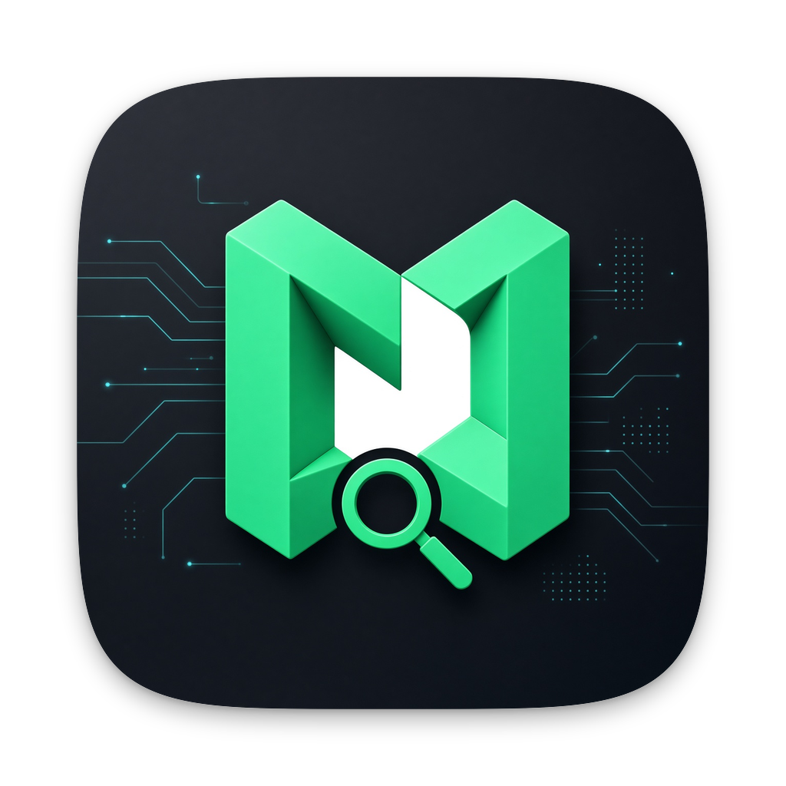

# mmlmRAGUI

[中文](README.zh-Hant.md)

<p align="center">
  
</p>

<p align="center">
  <a href="https://github.com/mark1688288/mmlmRAGUI"></a>
  <a href="#2-install-mmlmragui"></a>
  <a href="https://developer.apple.com/swift/"></a>
  <a href="https://github.com/mark1688288/mmlmRAG"></a>
  <a href="LICENSE"></a>
</p>

A macOS app for the local [mmlmRAG](https://github.com/mark1688288/mmlmRAG) `rag` command.

Install mmlmRAG first, then install this app, then set the local rag path and the working directory.

## 1. Install mmlmRAG

```bash
brew install mark1688288/mmlmrag/mmlmrag
```

Ollama and the model setup are in the [mmlmRAG](https://github.com/mark1688288/mmlmRAG) README.

## 2. Install mmlmRAGUI

Download the latest app from [Releases](https://github.com/mark1688288/mmlmRAGUI/releases), move it into the Applications folder, and open **RAGUI**.

The app runs on Apple Silicon.

## 3. Settings

Open **RAGUI → Settings…** (⌘,), then **System**.

**rag path** is the installed `rag` command. After the Homebrew install above, that is `/opt/homebrew/bin/rag`. Press **Use This Path**.

A local mmlmRAG checkout also works. Point **rag path** at the folder that contains `src/ragcli/cli.py` and `rag.toml`.

**Working Directory** is the corpus workspace. That folder, or a parent of it, must contain `rag.toml`. Otherwise `rag` uses `~/.mmlmrag/rag.toml`.

Press **Check Again** and confirm that `rag` runs.

## Privacy

This app keeps questions, answers, and settings on your Mac. See [PRIVACY.md](PRIVACY.md).

## Security

Report an unfixed vulnerability with [Report a vulnerability](https://github.com/mark1688288/mmlmRAGUI/security/advisories/new). The process is in [SECURITY.md](SECURITY.md). Do not use a public issue.

## License

Copyright (C) 2026 mark1688288. Licensed under the GNU Affero General Public License, version 3 only. The full text is in [LICENSE](LICENSE).
