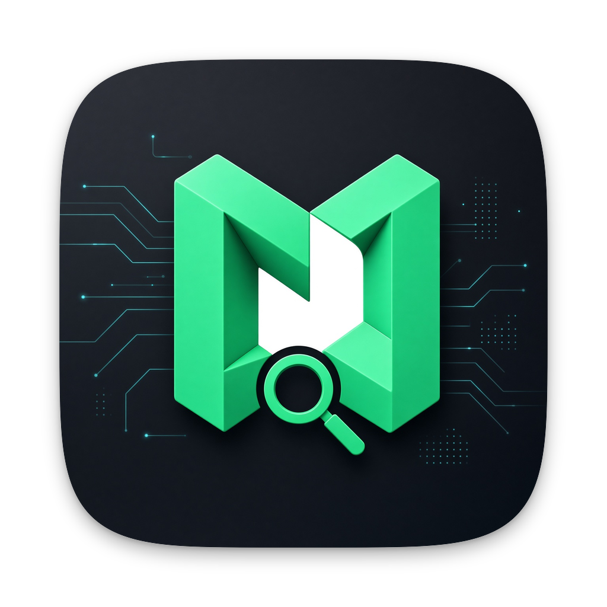

# mmlmRAGUI

[English](README.md)

<p align="center">
  
</p>

<p align="center">
  <a href="https://github.com/mark1688288/mmlmRAGUI"></a>
  <a href="#2-安裝-mmlmragui"></a>
  <a href="https://developer.apple.com/swift/"></a>
  <a href="https://github.com/mark1688288/mmlmRAG"></a>
  <a href="LICENSE"></a>
</p>

適用於本機 [mmlmRAG](https://github.com/mark1688288/mmlmRAG) `rag` 命令的 macOS 應用程式。

請先安裝 mmlmRAG，再安裝此應用程式，然後設定本機的 rag 路徑與工作目錄。

## 1. 安裝 mmlmRAG

```bash
brew install mark1688288/mmlmrag/mmlmrag
```

Ollama 與模型準備見 [mmlmRAG 說明](https://github.com/mark1688288/mmlmRAG/blob/main/README.zh-Hant.md)。

## 2. 安裝 mmlmRAGUI

從 [Releases](https://github.com/mark1688288/mmlmRAGUI/releases) 下載最新的應用程式，移至「應用程式」資料夾，然後開啟 **RAGUI**。

此應用程式在 Apple Silicon 上執行。

## 3. 設定

開啟 **RAGUI → 設定…**（⌘,），然後進入 **系統**。

**rag 路徑**是已安裝的 `rag` 命令。依上述 Homebrew 安裝後，路徑為 `/opt/homebrew/bin/rag`。按 **使用此路徑**。

亦可使用本機的 mmlmRAG 原始碼。將 **rag 路徑**指向含有 `src/ragcli/cli.py` 與 `rag.toml` 的資料夾。

**工作目錄**是語料庫工作區。該資料夾或其上層資料夾必須含有 `rag.toml`。否則 `rag` 會使用 `~/.mmlmrag/rag.toml`。

按 **重新檢查**，確認 `rag` 可以執行。

## 私隱

此應用程式將問題、回答和設定留在你的 Mac 上。見 [私隱政策](PRIVACY.zh-Hant.md)。

## 安全性

尚未修復的漏洞請經由[回報漏洞](https://github.com/mark1688288/mmlmRAGUI/security/advisories/new)提交。程序見 [SECURITY.md](SECURITY.md)。請勿使用公開的 Issue。

## 授權

Copyright (C) 2026 mark1688288。以 GNU Affero General Public License 第 3 版（僅此版本）授權，全文見 [LICENSE](LICENSE)。
